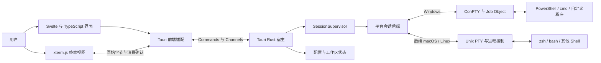
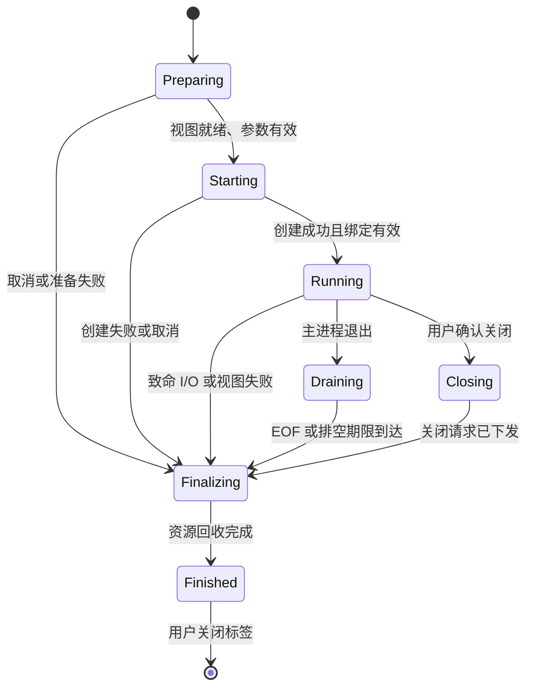
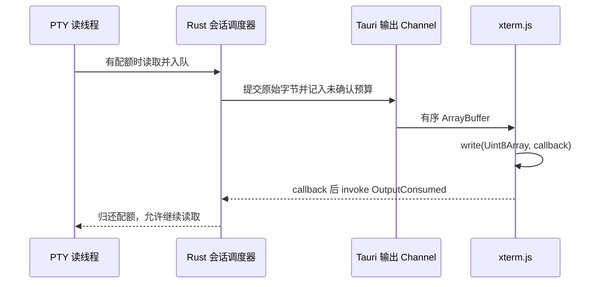

# Terminder 设计开发方案

> 设计基线：2026-10-20。状态：从零设计，主路线为 Rust + Tauri 2 + TypeScript + xterm.js，待 M0 原型验证。
>
> 本文独立定义产品、架构和开发顺序，不以现有实现、目录结构、依赖或代码复用为约束。本轮交付是设计文档；文中的性能数字、支持矩阵与验收项均为开发目标，尚不代表已经实现或测试通过。

## 1. 产品定位与设计结论

Terminder 是面向开发者的桌面终端模拟器：提供窗口、标签页、终端显示和输入能力，通过操作系统的伪终端运行用户选择的 Shell 与命令行程序。先完成可日常使用的 Windows 版本，再交付 macOS 和 Linux 版本。

Shell 负责命令解释、管道、补全和历史记录；Terminder 负责承载 Shell。产品模型支持多种 Shell，PowerShell 是 Windows 上的默认选择之一。

本方案按“Windows 稳定交付 → 正确的终端行为与资源回收 → 跨平台维护成本 → 开发效率”的顺序取舍，选择 **Rust + Tauri 2 + TypeScript + xterm.js**。界面默认使用 Svelte 5 + Vite，Rust 集中管理会话和系统资源。这里的优选是针对这些目标的工程判断，实际性能和平台兼容性仍须由原型证明。

### 1.1 核心决策

| 事项 | 本方案的决定 | 原因与边界 |
| --- | --- | --- |
| 首发平台 | Windows 11 x64 | 先形成可安装、可日常使用的交付面；其他系统和架构分阶段验证 |
| 普通构建运行下限 | Windows 10 21H2 x64（build 19044） | 2026-10-20 按用户要求放宽；默认构建可进入会话创建，正式支持仍须单独完成平台与资源回收验收 |
| 桌面宿主 | Tauri 2 + Rust | 使用其窗口、IPC、权限和打包机制，应用内核保持独立 |
| 应用界面 | Svelte 5 + TypeScript + Vite | 标签、设置与终端组件位于同一前端；首版不引入 SSR 或前端服务端 |
| 终端引擎 | xterm.js，按能力启用 WebGL | 复用终端解析、输入和显示能力，保留 DOM 降级 |
| 平台会话后端 | Windows ConPTY / 后续 Unix PTY | 优先验证 `portable-pty` 适配；Windows 所有权与取消缺口通过受限原生适配补齐，M0 定案 |
| 终端状态 | xterm.js 独占缓冲区 | 原始字节、Grid 和选区不进入 UI 响应式状态 |
| 通信 | Tauri Commands + 有序二进制 Channel | 控制与数据分流，应用层保留消费确认和背压；不增加本地网络服务 |
| 生命周期 | 应用拥有会话，会话拥有进程与 I/O 资源 | 首版不提供后台驻留或断线重连；关闭必须完成清理 |
| 恢复 | 按保存的启动信息创建新会话 | 不承诺恢复原进程、正在执行的命令或完整终端现场 |
| 替代路线 | Dioxus 作为有限原型对照，原生 GPU 路线作为专项候选 | 不同时维护两个产品 UI，也不把未实测的技术偏好当成性能结论 |

### 1.2 成功标准

- 用户安装后，无需 Rust、Node.js 或开发工具即可启动本机 Shell。
- PowerShell、Windows PowerShell 和 cmd 的基础交互，以及代表性全屏 TUI，能在真实 ConPTY 中工作。
- 多会话之间的输入、输出、大小和退出状态相互隔离。
- 持续输出、中文输入、窗口缩放、后台标签页和关闭流程均有明确的行为与资源上限。
- macOS/Linux 的接入以增加平台实现和验收为主，不重写产品状态、配置模型或会话编排。

## 2. 产品范围与平台计划

### 2.1 Windows 首发范围

| 能力 | 首发要求 |
| --- | --- |
| 本地 Shell | 自动发现 PowerShell 7、Windows PowerShell 5.1、cmd；允许配置其他本机可执行程序 |
| 多标签页 | 新建、切换、关闭、重命名；每个标签页一个独立会话 |
| 终端基础 | VT/ANSI、光标、颜色、选择、滚动、复制粘贴、搜索、备用屏幕、常用鼠标报告 |
| 输入体验 | 中文 IME、常用键盘布局、应用快捷键与终端按键分流 |
| 显示 | 字体、字号、深浅主题、DPI 变化、调整窗口大小、GPU 失效后的可用显示 |
| 配置 | Shell Profile、参数、环境变量、启动目录、外观、快捷键、资源限制 |
| 生命周期 | 启动错误、进程退出、终端视图失败、关闭确认、进程与句柄回收 |
| 持久化 | 配置安全写入、窗口几何恢复、可选的标签页启动信息恢复 |
| 交付 | Windows 安装包、WebView2 检测与安装说明、离线资源、诊断信息 |

用户在 Shell 中运行 `ssh`、`git` 等命令属于普通终端使用。内置 SSH 连接管理、凭据管理、WSL 发行版管理均不在首发范围。

### 2.2 后续阶段

1. **Windows 完善**：分屏、标签排序、命令面板、可选 Shell Integration、WSL Profile、Windows ARM64。
2. **macOS 交付**：Unix PTY、系统登录 Shell、菜单和快捷键、中文输入、签名与公证。
3. **Linux 交付**：发行版依赖、Wayland/X11、输入法、字体、剪贴板和打包验收。
4. **按实际需求评估**：内置远程连接、日志导出、扩展机制。每项单独设计权限与资源边界。

跨平台基础检查可以提前进行，但不能因此拖延 Windows 核心路径，也不能提前宣称 macOS/Linux 已受支持。

### 2.3 平台支持口径

| 平台 | 设计阶段的目标 | 发布条件 |
| --- | --- | --- |
| Windows 11 x64 | 首个正式支持平台 | M0 固定最低系统 build，M4 覆盖最低和发布时选定的较新 build |
| Windows 10 21H2 / 22H2 x64 | 普通构建放行（最低 build 19044）；正式兼容待验收 | 单独测试后才列入正式支持范围；保留已发现的 ConPTY 句柄增长问题，不由 API 可用性或版本放行推导稳定性 |
| Windows ARM64 | 后续目标 | 原生依赖、WebView2、Shell 发现与安装包均通过验证 |
| macOS Apple Silicon | 首个 macOS 目标 | 在该阶段固定最低系统版本，并完成实际 WKWebView/PTY 验收 |
| macOS Intel | 按用户需求增加 | 独立构建和测试，不把 Apple Silicon 通过视为等价证据 |
| Linux x86_64 | 先支持一个明确版本的主流 LTS 发行版 | 固定 GTK/WebKitGTK 依赖和 Wayland/X11 验收环境 |

## 3. 技术路线评估

### 3.1 推荐组合与职责

Tauri 提供 Commands、面向流式数据的有序 Channels 和 Capabilities。原始字节可通过 Channel 作为 `ArrayBuffer` 送往前端，输入也可使用原始 IPC 请求体。[R03] [R04] [R23] 本项目选择这条路线，目的是复用已有桌面能力，并将应用 UI 与 xterm 的组件生命周期放在同一侧；这不是已测得的性能优势。

- **Rust 会话内核**：Profile 解析、PTY、进程、状态转换、资源预算、关闭与回收。
- **Tauri 宿主适配**：窗口、受限 Commands、Channel 绑定、配置读写、系统能力和退出协调。
- **Svelte + TypeScript UI**：标签、设置、搜索、对话框、焦点和界面草稿；不拥有 OS 会话资源。
- **独立 TypeScript 终端模块**：xterm 实例、输入编码、尺寸测量、输出消费确认；不依赖 Svelte 状态容器。
- **Vite / Node.js**：构建与测试前端静态资源；用户运行产品不需要 Node.js。

Svelte 是本项目的默认 UI 实现选择，Tauri 官方提供相应模板。[R24] 首版使用普通静态前端，不引入 SvelteKit、SSR、服务端路由或额外 UI 状态框架。xterm 使用命令式 API，其缓冲不进入组件响应式系统。

Tauri 与 Dioxus Desktop 都使用系统 WebView 体系；Windows WebView2、macOS WebKit、Linux WebKitGTK 的差异仍需验收。[R01] [R02] 切换宿主不能自动解决输入法、字体、GPU 或系统 WebView 的限制。

### 3.2 方案比较

| 路线 | 对本项目的主要收益 | 主要成本与不确定性 | 结论 |
| --- | --- | --- | --- |
| Rust + Tauri 2 + TypeScript + xterm.js | 应用 UI 与终端模块同侧集成；复用有序原始字节传输、权限和分发机制 | UI 转向 TypeScript；背压、IME、WebView 与 PTY 仍须实测 | **正式主路线，M0 验证后进入完整开发** |
| Rust + Dioxus Desktop + xterm.js | 应用 UI 可使用 Rust，与 Rust 团队习惯一致 | 终端仍需 JS；需要协调 Rust UI 与 JS 组件，验证消息桥接与打包 | **有限对照路线**；只有证据显示更符合目标时才重新决策 |
| Rust + Iced + `alacritty_terminal` + 自定义 GPU 视图 | 直接控制终端解析和绘制路径 [R05] [R06] | 自行完成文字布局、输入法、选区、可访问性和终端控件集成 | WebView 确实无法满足明确指标时再立专项 |

M0 共用同一会话后端、终端负载与设备，对 Tauri 主原型和最小 Dioxus 对照进行一次有范围的比较，记录接入工作量、输入、输出和关闭行为。对照只需要单终端及基础标签切换，不建设第二套设置、发布或业务模块。两者均满足需求且没有实质反证时，继续已选择的 Tauri 路线。

### 3.3 依赖与构建基线

本设计采用 Tauri 2、Svelte 5、TypeScript 严格模式、Vite、xterm.js 6.x；`portable-pty` 0.9.0 为 PTY 复用候选。[R08] [R09] 这些是选型范围，不等同于完整版本锁定。M0 固定实际兼容组合、工具链和测试环境后，才开始扩展功能。

| 领域 | 选择 | 使用约束 |
| --- | --- | --- |
| Rust | 经验证的稳定工具链 | 写入 `rust-toolchain.toml`，记录 MSRV 与 MSVC 目标 |
| 宿主 | Tauri 2、`@tauri-apps/api`、Tauri CLI | 核心 Rust/npm API 按相同 minor 配对，插件两侧精确版本对齐；CLI 使用已验证组合 [R07] |
| UI | Svelte 5 + TypeScript | 仅处理界面和会话投影；状态所有权见第 4、5 节 |
| 前端构建 | Vite + npm 锁文件 | 单个前端包，统一构建 UI 与终端模块；不再另设终端资源 bundler |
| 终端 | `@xterm/xterm` 6.x | 首轮可使用已核对的 6.0.0；Fit、Search、WebGL addon 按兼容关系锁定 |
| PTY | 平台接口下的 `portable-pty` 候选及必要适配 | 复用优先，但不得牺牲进程组、取消或回收契约 |
| Windows API | 必要时使用 `windows` crate | 限定在 Windows 模块，明确 unsafe 与句柄所有权 |
| 并发 | 宿主统一异步运行时 + 受管阻塞 I/O | 复用 Tauri 的异步运行时接口，独立内核测试自行提供运行时 [R25] |
| 配置 | `serde`、TOML / `toml_edit`、JSON | 保留用户注释；版本化工作区状态，不引入数据库 |
| 错误与诊断 | `thiserror`、`tracing` | 结构化错误和脱敏诊断，默认不记录终端内容 |

前端类型声明不能替代 Rust 端输入校验。Rust DTO 与 TypeScript 模型通过协议夹具验证一致性；首版不为少量模型增加一套自定义代码生成系统。

### 3.4 PTY 后端的决策门槛

优先检查 `portable-pty` 的公开 API、实现与原生契约测试，验证创建、尺寸、读写分离、独立终止和资源释放。其跨平台 API 可复用，但 `ChildKiller::kill` 仅描述终止子进程，不能据此承诺整组清理。[R09] [R26]

Windows 后端在 M0 按以下顺序定案：

1. 若现有库满足第 5、6 节全部契约，使用薄适配层。
2. 若缺口可以通过明确的扩展点或可维护的小范围补丁解决，复用主体实现，并记录补丁、许可、上游跟进和退出条件。
3. 若无法保证创建时建立进程归属、阻塞 I/O 取消或可控关闭，仅实现必要的 Windows ConPTY 后端；Unix 仍可复用已有库。

不以“先创建 Shell，再按 PID 追加入 Job”替代创建阶段的所有权保证。M0 结束时必须确定一个 Windows 正式后端，后续阶段不长期维护多套可切换实现，也不自行重写全部平台 PTY。

所有依赖以 lockfile 固定实际解析结果，并检查维护、许可与安全状态。技术替换以同一契约和负载的证据为依据。

## 4. 架构与工程组织

### 4.1 运行时结构



一个应用宿主实例管理一个主窗口和多会话。WebView 可以创建多个辅助进程，内存评估须计入这些进程。首版不增加会话守护进程、远程服务或插件宿主。

### 4.2 职责与依赖方向

| 模块 | 拥有的数据或资源 | 允许的依赖 | 不承担的职责 |
| --- | --- | --- | --- |
| 前端 UI | 标签布局、活动项、焦点、对话框、编辑草稿 | 应用动作、终端模块、会话只读投影 | PTY I/O、直接操作进程 |
| TerminalView | xterm、输入事件、显示、选区和消费进度 | xterm 公共 API、传输接口 | Tauri 插件、系统文件和进程能力 |
| 前端 transport | Channel、会话绑定、输入串行化、ACK | Tauri API、协议模型 | Shell 解释、自动重试未知结果的输入 |
| Rust 宿主 | IPC 权限校验、窗口归属、配置写入和退出协调 | 会话内核、Tauri、平台桌面能力 | 终端 Grid、组件布局 |
| 会话内核 | Profile 解析、SessionId、状态转换、预算和退出结果 | 平台后端接口、基础数据类型 | Tauri、Svelte、DOM、xterm 私有 API |
| 平台适配 | PTY、进程、Job/进程组、句柄与取消 | OS API 或通过验证的 PTY 库 | 界面交互与主题 |
| 持久化 | 配置文件、经校验的工作区快照 | 正式解析器、平台目录服务 | 保存进程句柄、输入记录或命令重放 |

前端布局与 Rust 会话状态各有唯一所有者。Rust 不复制标签编辑草稿；前端不能自行把会话改成 `Running` 或 `Finished`。工作区保存时由前端提交布局，Rust 验证并写入；恢复时 Rust 返回快照，前端按启动协议创建新会话。

依赖方向为桌面入口 → Tauri 宿主适配 → 会话内核 → 平台后端。终端前端通过 transport 接口使用宿主，内核不反向依赖 UI 或 Tauri。

### 4.3 建议目录

一个 Cargo workspace，包含桌面宿主和会话内核两个 Rust 包；一个 npm 前端包同时构建应用 UI 与终端模块。采用常规 `src-tauri` 布局，减少额外构建适配。

```text
terminder/
  Cargo.toml
  Cargo.lock
  rust-toolchain.toml
  apps/
    desktop/
      package.json
      package-lock.json
      vite.config.ts
      svelte.config.js
      tsconfig.json
      index.html
      src/
        App.svelte
        ui/                   # 标签、设置、搜索、对话框
        state/                # 布局、草稿、会话只读投影
        terminal/             # xterm 生命周期、输入、尺寸与显示
        transport/            # Tauri Commands / Channels 适配
        contracts/            # TypeScript 协议模型
      public/
        themes/
      src-tauri/
        Cargo.toml
        build.rs
        tauri.conf.json
        tauri.windows.conf.json
        capabilities/
        permissions/
        src/
          main.rs
          lib.rs
          commands/           # 受限 IPC 入口
          app/                # 窗口归属、运行时与退出协调
          config/             # 配置与工作区状态
          platform/           # 路径、剪贴板、链接、原生诊断
  crates/
    session-core/
      Cargo.toml
      src/
        model.rs
        profile.rs
        supervisor.rs
        transport.rs          # 不依赖 Tauri 的配额与会话通道契约
        backend/
          mod.rs
          portable.rs         # 候选库薄适配；按验证结果采用
          windows/            # Job、取消及必要的原生实现
          unix/               # 后续平台差异
      tests/
  tests/
    fixtures/                 # PTY 程序、VT 及双端协议夹具
    e2e/
    performance/
  docs/
    adr/
    verification/
```

这是目标工程结构，不是现有文件清单。`session-core` 可以脱离 GUI 测试，尚未接入的系统返回明确的不支持结果；前端生产产物在 `apps/desktop/dist/`，由 Tauri 构建链生成并打包。

## 5. 核心模型与生命周期

### 5.1 身份与数据所有权

| 概念 | 含义与约束 |
| --- | --- |
| `ProfileId` | 用户配置中的稳定标识；与显示名称分离 |
| `TabId` | 窗口中的标签标识；排序或重命名不改变标识 |
| `SessionId` | 一次真实进程会话；重启必须分配新标识，不复用旧进程身份 |
| `ViewEpoch` | 当前终端视图的绑定代次；过期桥接消息必须拒绝 |
| `SpawnSpec` | 已解析的可执行程序绝对路径、参数数组、环境增删项、目录和初始尺寸 |
| `TerminalSize` | 经校验的行列数；首轮建议每维 1–1000，另受资源预算约束 |
| `SessionSnapshot` | 生命周期状态、Profile、启动目录、退出原因、拥塞状态等元数据 |
| `WorkspaceSnapshot` | 窗口几何、标签启动信息和活动项；不含进程、输入或终端缓冲 |

首版 `TabId → SessionId` 为一对一关系。未来分屏增加 Pane 与 Session 的绑定，不让 Session 依赖标签布局。

运行中的可变会话状态由一个 Rust supervisor 串行拥有。TypeScript UI 持有会话只读投影、标签布局和编辑草稿，xterm 独占终端缓冲；三者不各自维护一份可修改的会话真相。

### 5.2 状态机



`Finished` 携带 `Exited(code)`、`ClosedByUser`、`SpawnFailed`、`IoFailed`、`ViewLost` 等原因，以及尾部输出是否完整。退出码、退出原因、资源清理结果分别记录，不混成一个成功布尔值。

- **Preparing**：验证 Profile，建立桥接并等待终端尺寸；未就绪时不启动 Shell。
- **Starting**：分阶段获取资源；任何步骤失败都回收此前获得的资源。
- **Running**：只有当前会话与视图绑定可接收新输入。
- **Draining**：主进程已退出，继续处理尾部输出；不能把“进程退出”当成“输出读完”。
- **Closing / Finalizing**：拒绝新输入，执行有期限的终止、排空、取消和回收；重复关闭返回当前进度。
- **Finished**：OS 资源和 I/O worker 已回收，终端保留为只读；重新启动创建新 SessionId。

准备与视图握手初始期限为 5 秒，进程创建阶段初始期限为 10 秒；超时触发取消和回收，迟到的创建结果也必须清理。超时返回不等于底层操作已取消。

清理失败时保持 `Finalizing` 并报告失败和恢复动作，不能伪造为已完成。关闭过程中 UI 不等待阻塞系统调用。

### 5.3 后端契约

平台后端提供创建、独立读取、串行写入、尺寸更新、观察退出、请求关闭、强制终止和资源回收能力；具体句柄只在后端内部存在。

核心不变量：

1. 同一会话输入与输出各自有序，不与其他会话混流。
2. Shell 启动成功以前，不发布 `Running`；启动取消与完成竞争时，由 supervisor 决定唯一结果。
3. 同一会话只发布一次最终结果；退出、EOF、用户关闭和错误可以以任意顺序到达。
4. 不持有共享锁执行读写、等待进程、等待队列或跨语言调用。
5. 正常运行时不丢弃终端字节；允许合并的是标题、活动标记、resize 等可替代元数据。
6. 所有队列、会话数和 worker 数有上限；取消信号与关闭操作不依赖输出队列腾空。
7. 进程会话不因普通标签切换、设置打开或组件重渲染而重启。

## 6. Windows Shell 与进程管理

### 6.1 Shell 发现与启动

自动选择按 PowerShell 7 → Windows PowerShell → cmd 的顺序执行。发现阶段可检查标准安装位置、受控的 PATH 条目及已验证的应用别名；使用前解析为明确的可执行路径，不让工作目录中的同名程序隐式优先。

- 自动选择只在候选程序不存在或平台不适用时尝试下一项。
- 用户明确选择的 Profile 启动失败时，显示该错误，不偷偷换成另一种 Shell。
- 权限拒绝、参数错误、Profile 脚本错误与“程序未安装”分别呈现。
- PowerShell 默认可用 `-NoLogo`；尊重用户原有 Profile，不默认添加 `-NoProfile` 或 `-ExecutionPolicy Bypass`。
- 自定义 Profile 的程序和参数分开存储。使用经测试的 Windows 参数构造规则，不拼接为 `cmd /c ...` 或 PowerShell 命令字符串。
- 启动目录通过进程创建参数设置，不通过注入 `cd` 命令设置。
- 默认使用普通用户权限；不在应用内部混合管理普通和提权会话。

内置 Profile 是启动预设，不是核心中的 `PowerShellSession` 类型。所有 Shell 共用 `Session`，差异通过 Profile 与平台能力表达。

### 6.2 ConPTY 的边界

ConPTY 宿主通道传输 UTF-8 终端数据；应用使用输出流驱动终端模拟器，不能将其当作可分离的 stdout/stderr 日志。[R10] [R22]

- 首版以 UTF-8 终端链路为契约，保留原始分块字节；不对每次读取执行有损字符串转换。
- 创建独立终端时不启用 `PSEUDOCONSOLE_INHERIT_CURSOR`；未来若启用，必须连同关闭期间的光标查询应答一起实现并测试。[R10]
- 不全局修改系统代码页、用户 Profile 或系统环境变量。
- 老程序的代码页、重定向文件编码问题单独列入兼容案例；不承诺用一次 `chcp` 解决全部编码问题。
- 注入 `TERM_PROGRAM=Terminder` 和版本标识；`TERM`、`COLORTERM` 由平台默认值与 Profile 覆盖共同决定。Unix 接入时按已实现能力选择 terminfo 名称，不能宣称未验证的协议。
- 原生路径及参数在 Rust 内使用 `PathBuf` / `OsString`；仅在明确边界转换为展示文本。

### 6.3 进程组所有权

无论复用哪个 PTY 库，Windows 每个会话都必须有明确的进程所有权。正式后端每会话独占 Job Object，启用 `JOB_OBJECT_LIMIT_KILL_ON_JOB_CLOSE`，仅宿主持有必要且不可继承的 Job 句柄。Job Object 的成组终止范围是实际关联的进程。[R11]

创建阶段优先采用 `PROC_THREAD_ATTRIBUTE_JOB_LIST` 与 ConPTY 扩展属性一同建立关联。[R12] 若候选库不能在 Shell 获得运行机会之前完成这一步，则进入第 3.4 节的扩展或原生适配决策。不得通过降低“无失控后代”的验收标准保留不合适的库。

- 检查宿主已处于其他 Job 时的嵌套约束；不支持的启动环境应明确失败。
- 不启用主动 breakaway。纳入 Job 的后代随会话结束，包括符合该条件的 GUI 程序。
- 经系统服务、提权或其他代理启动的进程不自动视为可管理后代，不承诺可终止任意进程树。
- 独立的终止控制路径不能被阻塞的 `wait` 或 I/O 锁占住；启动各阶段失败均须回收已获得的资源。
- 宿主崩溃后的清理依赖 Job 句柄确实未泄漏或被继承，必须用故障注入验证。

### 6.4 I/O 线程与取消

ConPTY 通信使用同步 I/O，读写与关闭安排不当会产生死锁。[R10] 长期阻塞 I/O 使用受管线程；Tokio task 的 `abort` 不会取消已经开始的 `spawn_blocking`。[R13]

Tauri 宿主统一提供异步运行时和应用级会话注册表，内核只接收所需任务执行与取消能力；不再创建第二套宿主 runtime，也不为每个会话建立线程池。[R25]

原型以读、写各一条受管线程为起点，退出等待与关闭控制根据平台能力安排；每会话最多四条专用线程只是预算上限，并非必须建立四条。M0 根据独立取消、关闭时限和实测资源成本固定实现。

每个 worker 登记所有者、用途、取消方式、退出结果和 join 入口：

- 读线程在有输出配额时读取，关闭时能切换到排空路径。
- 写线程串行提交输入，停止时不接受新的写入。
- 进程退出等待不占用 UI 线程，不持有终止路径需要的锁。
- 对实际使用的 Windows 句柄与线程验证取消机制；仅设置原子标志不足以打断阻塞调用。
- 内核测试自行提供运行时，但使用相同生命周期契约；不能通过脱离 Tauri 的测试掩盖应用退出缺陷。

Tauri 的窗口关闭和应用退出事件统一进入关闭协调器，先阻止默认退出并完成会话清理，再放行退出；重复事件不能重复销毁资源。异常清理超时需提供明确的失败状态和强制退出动作，不能只移除前端标签或遗弃线程后报告成功。

### 6.5 关闭协议

以下协议由第 3.4 节选定的正式后端履行；复用库必须暴露足够的控制能力，否则不能宣称完成清理。

用户关闭正在运行的会话时，默认确认将结束该会话及其受管理程序。一次窗口关闭统一确认全部会话，避免逐标签弹窗。

1. 进入关闭阶段，拒绝新输入，停止分配新的常规输出帧。
2. 在非 UI 控制路径请求关闭 ConPTY；读线程继续排空输出，不依赖 JS 消费确认才能工作。
3. 给客户端有限的退出机会；初始宽限目标为 1.5 秒，之后终止仍存活的 Job 成员。
4. 等待进程退出与输出 EOF；尾部排空初始期限为 2 秒。输出在有限预算内尽量送达仍有效的视图。
5. 强制关闭、视图丢失或排空超时允许放弃剩余显示数据，但必须标记尾部不完整；这不改变正常运行不丢字节的约束。
6. 取消剩余阻塞操作，回收 reader、writer、控制和等待 worker，释放各句柄；完成后才进入 `Finished`。

不要通过发送 `exit\r`、Ctrl+C 或关闭输入管道来宣称实现了通用的“优雅退出”：前台可能是编辑器，Shell 也未必处于提示符。

微软文档说明，`ClosePseudoConsole` 的行为从 Windows 11 24H2、build 26100 起发生变化；较早版本可能等待关闭完成，而关闭期间仍可能产生输出。[R14] 因此应持续排空并独立观察 EOF，不能用函数返回或某一个系统版本的测试代替完整回收证据。

## 7. Rust 与终端视图的通信

### 7.1 Commands、Channels 与字节路径

传输分为三条路径：

| 路径 | 机制 | 用途与边界 |
| --- | --- | --- |
| 控制请求 | 受限 Tauri Commands，结构化 JSON | 准备/启动、resize、ACK、关闭、配置等低频动作 |
| 会话状态 | 每个绑定独立的类型化 Channel | 启动、退出、错误、输出结束；不广播到无关窗口 |
| 终端输出 | `Channel<tauri::ipc::Response>` | Rust 发送原始字节，前端接收 `ArrayBuffer` 并交给 xterm |

输入采用 `invoke` 的原始 `Uint8Array` 请求体，Rust 从 `tauri::ipc::Request` 取字节；SessionId、ViewEpoch、输入序列放在受限请求头中。[R23] 后端从实际调用上下文取得窗口身份，不相信前端自报的窗口标识。

Tauri 已提供 Channel 内的有序投递。[R03] [R23] 不再为终端字节设计 JSON + Base64 包装，不通过全局 Event 广播输出，也不逐块执行 JavaScript 源码。框架 IPC 仍可能复制和缓存数据，不能宣称零拷贝或天然有界。

首次绑定时记录窗口、SessionId、ViewEpoch 与协议版本。每会话拥有独立 Channel，因此输出载荷只包含 PTY 字节，不再添加自定义二进制帧头。

### 7.2 启动与绑定协议

1. UI 调用 `prepare_session`，Rust 校验 Profile 和会话配额，返回 SessionId、ViewEpoch、协议版本；此时不创建 Shell。
2. 前端创建 xterm、完成字体与尺寸测量，并注册输出及状态 Channel 的处理器。
3. 前端调用 `start_session`，提交绑定信息、初始尺寸与两个 Channel。Rust 验证实际调用窗口、绑定和状态后才创建进程。
4. 成功后通过状态 Channel 发布 `Running`；失败或准备超时回收预约、句柄及 Channel。前端不能因 Command 返回“已接受”就自行认定进程启动成功。
5. 重启创建新 SessionId 和新 Channel；视图代次变化使旧回调、输入和 ACK 全部失效。

处理器必须在启动请求之前就绪，避免程序早期输出到达时无人接收。组件销毁前先结束所属会话，不能仅注销监听器而留下进程。

### 7.3 消息与确认语义

| 操作或消息 | 方向 | 关键内容与语义 |
| --- | --- | --- |
| `PrepareSession` / `StartSession` | UI → Rust | Profile、请求标识、绑定、尺寸与 Channel；按第 7.2 节执行 |
| `Input` | JS → Rust | 头部含绑定与输入序列，原始请求体含字节；也承载终端协议应答 |
| `InputAccepted` / `InputRejected` | Rust → JS | 队列是否接受及原因；不表示 Shell 已执行 |
| `Resize` | JS → Rust | 尺寸与 revision；只应用最新有效请求 |
| `Output` | Rust → JS | 当前绑定 Channel 上的一块原始字节，不经过文本重编码 |
| `OutputConsumed` | JS → Rust | 已连续解析到的块序号和累计字节数，用于归还配额 |
| `OutputEnd` | Rust → JS | 最后块序号、累计字节数、截断标志；作为尾部完成屏障 |
| `SessionState` | Rust → JS | 生命周期与退出原因，前端只更新投影 |
| `CloseSession` / `ViewFailed` | UI → Rust | 用户关闭或确定的视图损坏；进入统一资源回收流程 |

块序号是应用层确认计数：Rust 对提交的每块输出计数，前端按有序 Channel 回调递增相同计数。两侧记录字节累计值，用确认前缀匹配；不读取或依赖 Tauri 内部 Channel 索引。

SessionId 与 ViewEpoch 使用不透明字符串；跨 JS 传递的 64 位计数使用十进制字符串并校验范围，前端内部可使用 `bigint`。

- Rust 校验调用窗口、会话归属、状态、头部、长度与请求速率。Channel 本身不替代会话授权。
- `Input` 经前端单一有界发送队列串行提交；Rust 校验序列，避免并发 `invoke` 到达顺序变化。
- ACK 只能确认已发送的连续前缀；重复 ACK 幂等，越界或字节计数不匹配为协议错误。
- 输入在当前绑定内识别重复序列；断开后不自动重发，不推测不确定的命令执行结果。
- 状态 Channel 与输出 Channel 之间没有全局顺序。退出通知或 `OutputEnd` 先到时，视图等待指定输出前缀消费完成，或明确标记超时/截断。
- 控制操作拥有独立预算和调度机会；关闭使用独立取消路径，不等待输出队列腾空。
- 类型声明只表达开发期预期；版本不匹配、错误绑定与载荷异常均须有双端拒绝测试。

### 7.4 输出背压

Tauri Channel 的有序性不等于终端已经消费，也不能代替流控。xterm 的 `write` 为异步入口，其 callback 表示该块已处理，不等于像素已经显示。[R15] [R16]



JS 按连续消费前缀合并 ACK。Rust 在提交 Channel 前预留配额，不能把 `send` 成功当成归还配额的依据；发送失败进入绑定错误与清理流程。

预算耗尽时停止提交和进一步读取，让压力传回 PTY。正常运行不能删除旧字节以保留“最新画面”，否则会破坏跨块 UTF-8、控制序列与终端状态。

多个会话按轮转和每轮字节预算调度，防止一个刷屏会话占满 IPC。低流量及时发送，高流量小批量合并；控制 Channel 不承载原始输出。

### 7.5 初始资源预算

以下是 M0 的调参起点。既限制字节，也限制块数，并验证应用缓冲、框架 IPC 和 xterm 未消费数据的组合成本。

| 资源 | 初始值 | 达到限制时 |
| --- | --- | --- |
| 活跃会话 | 每实例 16 个 | 拒绝新建并说明限制 |
| 单输出块原始载荷 | 最大 32 KiB | 有序拆块 |
| 输出批次等待 | 最长 8 ms 或满块即发 | 避免低流量长期攒批 |
| 每会话已读待发送数据 | 最多 1 MiB / 128 块 | 读线程等待可取消配额 |
| 每会话已提交未确认输出 | 最多 256 KiB / 64 块 | 暂停提交；消费确认后继续 |
| 实例总输出原始数据预算 | 16 MiB，含排队与未确认部分 | 公平分配配额并暂停对应读取 |
| 输入块 | 最大 16 KiB | 有序拆分，不静默截断 |
| 每会话待写输入 | 512 KiB，包含粘贴包装字节 | 显示忙碌，拒绝未接受的数据 |
| 单次用户粘贴 | 最大 256 KiB | 开始写入前拒绝超限粘贴 |
| 控制队列 | 每会话最多 64 条，每条最多 8 KiB | 合并可替代元数据；关闭走独立取消路径 |
| 历史缓冲 | 默认 5,000 行，配置上限 20,000 行 | 按规则淘汰完整历史行 |

这些是应用预算，不是总 RSS 的硬上限。M0 计入 Rust/JS 临时副本、框架 IPC、终端历史和 WebView，固定可接受的会话数、行列数及历史容量组合；超预算配置须拒绝或要求降低历史容量。

前端输入队列同样有界。预留一整次粘贴额度后再提交；部分写入后发生 I/O 错误时提示结果不完整，不自动重试。

ACK 长期未到只表示消费停滞，应显示拥塞并停止增量分配；不能单凭超时认定 WebView 死亡。确定的视图损坏按第 8.4 节处理。

## 8. 终端模拟、输入和显示

### 8.1 终端引擎

xterm.js 负责 VT 状态、屏幕/备用屏幕、光标、选区和历史缓冲。Rust 转发字节并管理资源，不再维护一份终端 Grid，也不通过正则表达式解析整个输出流。

初始模块组合为核心、Fit、Search，以及按能力启用的 WebGL addon。xterm.js 6 已移除 Canvas addon，应使用 WebGL 或内置 DOM 渲染器。[R08]

- 默认探测可用的 WebGL；失败或 context lost 时降级到 DOM，并保留已有终端状态。
- 首版同一窗口最多为活动标签保留一个 WebGL 渲染实例；切换可重建 addon，不重建 xterm 缓冲和会话。
- 终端资源、样式与需要分发的字体均随安装包提供，不从 CDN 动态加载。
- 不依赖未声明的 proposed/private API；若确有需要，必须固定版本并加入升级契约测试。
- 首版不承诺图片协议、Kitty 键盘协议或完整 xterm 扩展集合。支持范围以协议夹具及实际程序矩阵为准。

### 8.2 字节与键盘输入

xterm.js 对 `Uint8Array` 按 UTF-8 流解析，可处理跨分块码点；`onData` 产生文本，`onBinary` 用于不能按普通 UTF-8 转换的二进制输入。[R17]

- `onData` 经 UTF-8 编码进入输入队列。
- `onBinary` 按逐字节语义传递，不能再次按 UTF-8 编码破坏鼠标报告。
- IME composition 期间不抢占组合键、不提前提交字符；使用终端组件的文本输入路径，不用应用组件的 `keydown` 逐字符模拟输入。
- 应用快捷键先按作用域判断，未匹配的键交给终端；Ctrl+C、Ctrl+D、Ctrl+Z 等保持终端语义。
- Windows 的 AltGr、功能键、数字键盘和不同布局，macOS 的 Option/Command，均分别测试。
- 终端查询产生的应答同样经过受控输入路径，不能只转发用户键盘事件。

### 8.3 尺寸和隐藏标签

1. 字体加载并且容器可测量后计算行列数，初始化 xterm 和 PTY。
2. 容器、字号、DPI 或显示器发生变化时，合并短时间内的 resize 请求。
3. xterm 与 PTY 使用同一最终尺寸及 revision；后端拒绝非法值，应用显示失败而不是假定同步成功。
4. 容器暂不可见或大小为零时保留最近有效尺寸；不能把 PTY 调成 `0 × 0`。
5. 非活动标签保留终端实例，继续解析并确认输出，可降低绘制频率；不能因隐藏而永久停止 ACK。
6. 窗口最小化或系统挂起导致 JS 被节流时，依靠有界背压保护内存；恢复后继续消费，不以丢输出换恢复速度。

切换标签只改变可见性和焦点。终端容器使用稳定 key，由终端模块拥有其子 DOM；Svelte 不参与重建内部字符节点。挂载时创建实例，最终卸载时统一 dispose addon、DOM 监听器和 transport；普通响应式更新不重复初始化。组件的挂载与清理由显式生命周期钩子管理。[R27]

### 8.4 视图丢失

首版不维护服务端完整终端快照，因此不承诺 WebView 崩溃后无损重建正在运行的终端。

- 普通组件重渲染不能销毁绑定；意外卸载应被视为缺陷。
- 确定的终端实例损坏或 WebView 崩溃后，Rust 宿主结束受影响的会话并清理资源；界面尚可用时显示重启入口，否则通过原生诊断提示，退出不依赖前端回调。
- 新建视图使用新 ViewEpoch；重新启动使用新 SessionId，旧消息全部失效。
- 不把任意一段末尾字节回放进空终端并声称恢复成功，也不自动重放用户输入。

未来若需要保留运行进程并重新附着，应单独设计终端快照、输出日志边界和会话宿主；这不属于简单更换 transport。

## 9. 界面与主要交互

### 9.1 窗口布局

```text
┌─────────────────────────────────────────────────────────┐
│ PowerShell  × │ cmd  × │ + / Profile                  窗口 │
├─────────────────────────────────────────────────────────┤
│                                                         │
│                    活动终端                              │
│                                                         │
├─────────────────────────────────────────────────────────┤
│ Profile · 目录来源 · 行列数                    会话状态     │
└─────────────────────────────────────────────────────────┘
```

首版使用标准窗口装饰和系统标题栏行为。自绘无边框、复杂透明效果和窗口材质不占用首发验证预算。

### 9.2 交互规则

- 首次打开窗口时启动默认 Profile；恢复标签开启时按快照启动新会话，受会话数上限约束。
- `+` 使用默认 Profile，旁边菜单选择其他 Profile；没有可用 Shell 时展示配置入口。
- Shell 正常退出后保留只读终端、退出码和重新启动入口，不循环自动重启。
- 关闭最后一个标签显示欢迎/新建页；关闭窗口执行统一的会话关闭流程。
- 用户重命名优先于程序上报标题；标题按文本显示并限制长度。
- 后台输出使用活动标记，不把每个输出块计为一条“未读消息”。
- 搜索仅覆盖当前终端保留的缓冲区，不承诺全量历史或系统 Shell 历史搜索。
- 错误就近展示，并给出重试、选择 Profile、修改目录或打开诊断的具体动作。

### 9.3 快捷键默认值

| 动作 | Windows / Linux | macOS 阶段默认建议 |
| --- | --- | --- |
| 新标签 | `Ctrl+Shift+T` | `Cmd+T` |
| 关闭标签 | `Ctrl+Shift+W` | `Cmd+W` |
| 下一个 / 上一个标签 | `Ctrl+Tab` / `Ctrl+Shift+Tab` | `Ctrl+Tab` / `Ctrl+Shift+Tab` |
| 复制 / 粘贴 | `Ctrl+Shift+C` / `Ctrl+Shift+V` | `Cmd+C` / `Cmd+V` |
| 搜索终端 | `Ctrl+Shift+F` | `Cmd+F` |
| 设置 | `Ctrl+,` | `Cmd+,` |
| 缩放字体 | `Ctrl++` / `Ctrl+-` / `Ctrl+0` | `Cmd++` / `Cmd+-` / `Cmd+0` |

快捷键可配置并检测冲突。设置输入框、搜索框与终端拥有不同作用域；只有明确匹配应用动作时才拦截，不在全局无条件阻止浏览器/系统事件。

### 9.4 粘贴与可访问性

复制来源为用户选择；粘贴必须有用户操作。多行、危险控制字符和超长内容先预览、确认或拒绝。拒绝超限粘贴发生在开始写入之前。

使用 xterm 的粘贴入口遵守会话当前的 bracketed paste 模式，不自行重复添加控制序列。Bracketed paste 依赖前台程序配合，不作为命令不会执行的保证。

键盘应能到达标签、搜索和设置，关闭对话框后恢复合理焦点；活动状态不能仅靠颜色表达。首发人工验收包括 Windows Narrator、系统高对比度和字号缩放。GPU 渲染不替代可访问性树。

## 10. Profile、目录与持久化

### 10.1 配置模型

用户配置使用版本化 TOML。核心字段为：

- `default_profile`：ProfileId，或保留值 `auto`。
- `profiles`：标识、名称、适用平台、程序选择、参数数组、目录策略和环境增删项。
- `terminal`：字体、字号、主题、历史容量、渲染器偏好。
- `window`：窗口状态恢复、标签启动信息恢复。
- `session`：会话数量限制、关闭确认。
- `clipboard`：粘贴确认与大小限制。
- `shortcuts`：有作用域的动作映射。

程序选择支持 `resolver` 或绝对路径 `program`，二者互斥。`resolver` 是内置发现规则，不是要执行的命令字符串。`auto` 按平台选择内置 Profile，不能覆盖用户显式选择失败的结果。

### 10.2 Windows 配置示例

```toml
schema_version = 1
default_profile = "auto"

[terminal]
font_family = ["Cascadia Mono", "Consolas", "monospace"]
font_size_px = 14.0
theme = "system"
scrollback_lines = 5000
renderer = "auto"

[window]
restore_geometry = true
restore_tabs = false

[session]
max_sessions = 16
confirm_close_running = true

[clipboard]
confirm_multiline = true
max_paste_bytes = 262144

[shortcuts]
new_tab = "Ctrl+Shift+T"
close_tab = "Ctrl+Shift+W"
copy = "Ctrl+Shift+C"
paste = "Ctrl+Shift+V"
find = "Ctrl+Shift+F"
settings = "Ctrl+,"

[[profiles]]
id = "pwsh"
name = "PowerShell"
platforms = ["windows"]
resolver = "pwsh"
args = ["-NoLogo"]
cwd_policy = "inherit_known"

[[profiles]]
id = "windows-powershell"
name = "Windows PowerShell"
platforms = ["windows"]
resolver = "windows-powershell"
args = ["-NoLogo"]
cwd_policy = "inherit_known"

[[profiles]]
id = "cmd"
name = "Command Prompt"
platforms = ["windows"]
resolver = "cmd"
args = []
cwd_policy = "inherit_known"
```

示例中的字体按本机可用性回退，不假设 Cascadia Mono 必然已安装。内置发现器使用系统路径查询，不把系统盘固定为 `C:`。

校验包括重复 ProfileId、未知 resolver、路径和参数类型、目录存在性、平台适用性、环境变量合法性、快捷键冲突和数值上限。对未知字段报告位置并保留原文件，避免拼写错误被静默忽略。

运行时采用“内置默认值 → 用户配置 → 本次新建会话的显式选择”的优先级。外观修改可应用到现有终端；程序、参数、环境和启动目录修改只影响新会话。

### 10.3 工作目录

目录状态区分 `startup_cwd` 与 `reported_cwd`，后者带来源和有效性；没有可靠报告时界面显示“启动目录”，不能伪装成实时工作目录。

`inherit_known` 的选择顺序为：用户本次指定 → 当前会话已校验且允许继承的报告目录 → 当前会话启动目录 → Profile 预设 → 用户 Home。显式指定的目录无效时要求修正；历史继承候选失效时允许回退并提示。

基础 PTY 字节流不自动提供实时 cwd。可选 Shell Integration 在后续阶段实现，通过受限 OSC 处理器报告目录；该数据仍是进程可伪造的元数据，必须验证本机 host、URI 解码和目录合法性，不能据此自动执行命令或赋予权限。

非 UTF-8 原生路径在运行时不作有损回写。首版 TOML/JSON 文本持久化不能无损表示的路径，应跳过恢复字段并提示，不把替换字符后的显示字符串用于下次启动；未来若需要编码扩展，升级 schema。

### 10.4 文件位置与写入

| 内容 | Windows | macOS 计划 | Linux 计划 |
| --- | --- | --- | --- |
| 配置 | `%APPDATA%\Terminder\config.toml` | `~/Library/Application Support/Terminder/config.toml` | `$XDG_CONFIG_HOME/terminder/config.toml` |
| 工作区状态 | `%LOCALAPPDATA%\Terminder\state\` | `~/Library/Application Support/Terminder/state/` | `$XDG_STATE_HOME/terminder/` |
| 诊断日志 | `%LOCALAPPDATA%\Terminder\logs\` | `~/Library/Logs/Terminder/` | `$XDG_STATE_HOME/terminder/logs/` |
| WebView 数据 | 本机应用缓存目录的专用子目录 | 平台 WebView 对应目录 | 平台 WebView 对应目录 |

通过平台目录服务解析路径。Linux 遵循 XDG 的默认值和绝对路径要求。[R20] 不把配置、日志或运行状态写到安装目录。

写入采用同目录临时文件、完整序列化和校验、刷新、平台文件替换，并保留一份最近有效备份。Windows 替换需要处理 `ReplaceFileW` 等 API 的失败结果及原文件可能所处的位置，不能假定所有失败都自动保持原名。[R21]

- 配置读取失败时保留原文件，允许明确使用临时默认配置；不自动覆盖故障文件。
- 保存前检查文件是否已被其他编辑器或实例修改；检测到冲突时提示重新加载，不强行覆盖。
- 应用内配置写入由单一写入器串行处理；多实例使用写锁并检查文件版本。
- 设置编辑保留未触及项与注释，可采用 `toml_edit`；不能用整个默认对象覆盖用户文件。
- 日志轮转初始限制为每文件 10 MiB、最多 5 份；状态快照同样限制数量和总大小。

### 10.5 兼容与恢复

配置与工作区状态分别拥有 schema 版本。本文定义新产品的 v1 格式，不包含旧实现的数据迁移承诺；从 v1 对外发布起，后续升级必须定义兼容策略。

| 情况 | 行为 | 恢复路径 |
| --- | --- | --- |
| 已知旧 schema | 在内存迁移并校验，保留原文件备份后写入 | 从对应备份恢复；迁移失败不覆盖 |
| 未知较新 schema | 停止写回，提示使用匹配版本 | 保留文件，可使用临时默认设置 |
| 配置损坏 / 写入失败 | 错误可见，原内容和可用备份保留 | 修复、选择备份或明确重置 |
| 工作区状态损坏 | 跳过恢复项，启动可用窗口 | 保留错误快照用于诊断 |
| Profile / 目录已消失 | 标记恢复项不可用 | 用户选择替代，不静默执行其他程序 |
| 应用崩溃后重启 | 展示可恢复的启动信息 | 用户确认后新建会话，不重放命令 |

`restore_tabs` 默认关闭。启用后也仅按 Profile 与目录创建新进程；Shell 自身的启动脚本可能执行，应在设置中说明。工作区快照不保存终端输入、密钥、完整环境变量或 scrollback。

## 11. 安全与诊断边界

### 11.1 WebView 与本机能力

终端输出必须作为不可信数据。xterm 官方安全指南要求调用方妥善处理标题、链接、缓冲内容等暴露给应用的数据。[R18]

- 宿主只加载随包发布的前端资源，禁止远程页面导航、任意 iframe 和弹窗；Capability 不配置远程 URL 授权。
- 标题和错误使用文本节点，不使用 `innerHTML`，不把输出、路径或参数插入脚本源码。
- 在 `tauri.conf.json` 显式启用 CSP；Tauri 的 CSP 保护需配置后才生效。[R28] 保留所用版本必需的 IPC 来源，资源默认本地加载；验证 xterm 动态样式与 GPU 降级需要的策略，将必要例外限定到对应资源类型。
- `capabilities/` 按实际窗口 label 列出最小权限；不直接启用整组无关插件或暴露任意创建窗口能力。
- 将应用自定义 Commands 通过 `AppManifest::commands` 纳入权限定义并逐项授权。仅写一个 capability 文件不足以限制所有自定义命令，因为默认注册的应用命令可由应用各窗口调用。[R04]
- Commands 仍须检查实际调用窗口、会话归属、状态、路径和载荷长度。Capabilities 与 Channel 的存在不替代业务校验。
- 会话通道只由受限启动操作创建，绑定单个会话与当前视图代次；不暴露通用 `eval`、文件读写、系统命令执行或无范围限制的 Shell 插件接口。
- 用户配置的 Shell 只能经 Profile 与会话内核启动；Rust 处理配置、剪贴板和链接动作，不让终端组件直接调用系统插件。
- 正式构建关闭开发服务、热重载、默认开发者工具和自动化测试控制入口。

页面 JS 被攻破后仍可能操作其获准会话，窗口权限不是同页标签之间的强隔离。保持依赖与 WebView 更新、限制资源来源和使用最小命令集，才构成完整边界。

### 11.2 终端序列和外部动作

| 输入或动作 | 默认策略 |
| --- | --- |
| OSC 标题 | 文本化、限长、限制更新频率；不能覆盖用户自定义标题 |
| OSC 8 / 自动识别链接 | 仅用户明确点击后打开；首版只允许 `http` / `https`，展示目标 |
| OSC 52 剪贴板读写 | 默认拒绝；验证核心 handler 与 addon 都不会绕过策略 |
| 目录上报 | 作为受限元数据，不自动读文件、不改变权限 |
| BEL | 受限视觉提示，可关闭；避免持续通知或声音洪泛 |
| 不支持的图像/扩展序列 | 不加载相应能力；测试超长和畸形载荷不会拖垮应用 |
| 自定义 Shell Profile | 用户主动配置并选择；清楚展示程序、参数和环境覆盖 |

链接由 Rust 侧再次验证并调用平台打开能力，不让终端页面自己加载链接。首版不处理 `file:`、`javascript:` 或任意自定义 URL scheme。

### 11.3 日志与错误

记录会话创建/退出、状态转换、队列高水位、ACK 延迟、resize、资源计数和错误类别。默认不记录输入、终端输出、剪贴板、完整环境变量、完整命令参数或用户路径。

错误由类别、用户说明、系统错误码、阶段和会话标识组成。UI 提供可执行的恢复动作；详细诊断导出由用户触发，先展示将包含的内容，不默认上传遥测。

## 12. macOS 与 Linux 演进

### 12.1 从第一天保留的边界

- 业务模型使用 `Session`、`Profile` 和能力标志，不使用 Windows/PowerShell 专有类型。
- OS API 与平台依赖使用目标条件编译；跨平台核心测试不能隐式加载 Windows API。
- 路径、环境变量合并、程序发现、剪贴板、链接、快捷键分别适配，不能只替换 PTY 就宣称移植完成。
- Shell Integration 是可选能力，PTY 读写、resize 和基本退出不依赖它。
- 桥接和终端模块在三种系统 WebView 中使用相同协议，保留平台能力差异。

### 12.2 平台差异

| 领域 | Windows 首发 | macOS 后续 | Linux 后续 |
| --- | --- | --- | --- |
| PTY | ConPTY | Unix PTY / controlling terminal | Unix PTY / controlling terminal |
| 默认 Shell | 平台自动 Profile | 查询账户登录 Shell，可选 zsh/bash | 查询账户登录 Shell，可选 bash/zsh/fish |
| 进程控制 | Job Object + ConPTY 生命周期 | 终端挂断、会话/进程组、信号 | 同类 Unix 语义，按系统能力验证 |
| WebView | WebView2 | WKWebView | WebKitGTK，明确运行时依赖 |
| 输入 | IME、AltGr、Windows 快捷键 | Command/Option、系统输入法 | IBus/Fcitx、Wayland/X11 |
| 环境 | Windows 环境块和大小写规则 | Finder 启动环境与登录 Shell 差异 | 桌面启动环境、locale、XDG |
| 分发 | 安装器与 WebView2 依赖 | `.app` / `.dmg`、签名、公证 | 先选一种发行版包，再评估 AppImage/Flatpak |

Unix 后端需要建立正确的 session、controlling TTY、前台进程组和窗口尺寸。关闭时处理 PTY hangup、受管理进程组的终止与强制终止；仅杀根 Shell 或仅杀一个进程组都不足以证明所有交互作业已回收。

macOS/Linux 的作业控制和后代清理必须有原生集成测试，包括前台、后台、子 Shell 和主动脱离会话的程序。主动 daemonize 或经系统服务启动的程序不承诺可完整回收；产品边界在该平台正式发布前明确。不能把 Windows Job 的保证原样宣称为 Unix 保证。

### 12.3 接入顺序

1. M0/M1 先在可用的 macOS、Linux runner 运行会话模型和协议测试，发现平台 API 泄漏。
2. Windows 稳定后接入 Unix PTY，首先用无 GUI 测试程序验证 spawn、输入、resize、退出与清理。
3. 在真实 WKWebView / WebKitGTK 中验证终端桥接、字体、IME 和 GPU 降级。
4. 补齐平台配置目录、快捷键、原生菜单、环境获取和安装包。
5. 通过该平台完整验收矩阵后，才发布其支持版本与限制。

`portable-pty` 在第 3.4 节作为跨平台复用候选统一评估；Windows 的专有补丁不能泄漏到 Unix 契约，也不能免除上述测试。共享接口保留平台能力差异，不抽象出语义不明确的“通用 Unix Job Object”。

## 13. 性能目标与测量方法

### 13.1 测量基准

M0 固定一台 Windows 11 x64 参考设备，记录 CPU、内存、GPU、显示缩放、OS build、WebView2、字体、Rust/JS 依赖版本及电源模式。使用 release 构建和打包资源，不使用开发服务器或热重载。

以下是首轮目标，需在原型报告中填入实测值。调整目标应说明产品影响，不能为了通过而删去失败样本。

| 指标 | 首轮目标 | 测量边界 |
| --- | --- | --- |
| 首个可输入终端 | p95 ≤ 2 秒 | 进程启动至测试 Shell 可交互；测试禁用用户脚本，真实用户 Profile 另测 |
| 按键回显 | p95 ≤ 50 ms，p99 ≤ 100 ms | 输入事件到可见帧；记录桥接、PTY、解析和绘制分段耗时 |
| 标签切换 | p95 ≤ 100 ms | 8 个会话，切换后内容和焦点可用 |
| 持续输出 | 前台 WebGL 路径 5 MiB/s，持续 60 秒 | 120×40 字符视口，固定文本/VT 负载；无传输丢字节、无无限增长 |
| 刷屏时其他会话输入 | p95 ≤ 100 ms | 一个会话饱和输出，另一个执行确定性回显 |
| DOM 降级 | 完整保持输入、选择、resize 和关闭能力 | 吞吐另测、另报；不宣称与 WebGL 相同 |
| 内存 | 单空闲会话目标 ≤ 300 MiB；8 个默认历史会话目标 ≤ 900 MiB | 统计宿主及关联 WebView 进程的私有内存，Shell 内存单列 |
| 空闲 CPU | 平均低于一个逻辑核心的 1% | 60 秒窗口，标明光标闪烁、可访问性和 GPU 配置 |
| 会话清理 | 常规关闭 ≤ 5 秒 | 包括 worker join 和受管理进程退出；不能只测 UI 标签消失 |
| 长时稳定性 | 30 分钟持续/间歇负载，100 次创建关闭 | 内存进入稳定平台期；句柄、线程、子进程不逐轮累积 |

微基准区分“Rust 已读取”“JS 已收到”“xterm 已解析”“画面已刷新”。消费 ACK 只能用于解析进度，不能直接作为端到端显示延迟。

### 13.2 优化顺序

先修正错误的刷新、分配和调度，再根据测量调整块大小、ACK 批次、配额、Channel 提交节奏与 WebGL 生命周期。分别测 PTY、原始 IPC、xterm 解析和显示；有序二进制 Channel 不等于整条链路已优化。若瓶颈来自系统 WebView，更换 UI 框架未必有效；只有明确需求无法满足时才评估原生终端视图。

## 14. 验证策略与验收矩阵

### 14.1 测试分层

- **Rust 规则单测**：Profile、配置、状态转换、输入序列、过期绑定、配额和关闭幂等。
- **平台契约测试**：真实 ConPTY / Unix PTY、进程、目录、环境、尺寸、退出与清理；对候选库和原生适配使用同一套契约。
- **前端单测与组件测试**：TypeScript 类型、布局/焦点、快捷键作用域、组件挂载清理与设置草稿；终端输出不写入响应式状态。
- **双端协议测试**：原始字节 Channel、raw 输入请求、计数与 ACK、两个 Channel 的交错、窗口权限和版本拒绝；正式契约不只验证 IPC mock。
- **终端行为测试**：固定 VT 夹具、跨块 UTF-8、鼠标报告、选区、搜索、终端应答和渲染降级。
- **桌面端到端及故障注入**：真实 Tauri/WebView/Shell、慢消费者、阻塞读写、视图崩溃、磁盘错误和重复创建关闭。

测试 Shell 与辅助程序使用临时目录和受控环境。基线禁用用户 Profile，另设尊重真实 Profile 的兼容测试，避免污染用户配置。

桌面自动化优先评估官方文档支持的 WebDriver 路径，按平台固定驱动与测试方式。[R30] 若使用内嵌测试服务或测试插件，只允许出现在专用测试构建；发布产物另外验证不存在这些入口。浏览器模式可验证组件，不能替代真实 WebView 的 IME、IPC、权限或进程回收测试。

### 14.2 影响面 × 测试维度

当前交付只有设计，以下各项均未执行。实现阶段逐项填写“已覆盖 / 未覆盖 / 不适用”、命令、环境和证据文件；不能把设计覆盖等同于实现通过。

| 影响面 | 正常与边界断言 | 失败与恢复断言 | 兼容维度 | 当前状态 |
| --- | --- | --- | --- | --- |
| Shell 启动 | 三种内置 Shell；空参数、空格/中文路径、环境覆盖 | 缺失、拒绝访问、非法目录、启动中取消无泄漏 | 不同安装来源、用户 Profile | 未执行，M0/M1 |
| 字节与 VT | 中文/emoji 跨块、CSI/OSC 跨块、备用屏幕、终端应答 | 畸形与超长序列不失控，错误不会注入脚本 | PowerShell、cmd、确定性 VT 夹具 | 未执行，M0/M1 |
| 流控与顺序 | 原始字节摘要一致；输入顺序一致；多会话隔离 | 慢 ACK、重复/越界 ACK、跨 Channel 交错均保持预算 | Raw IPC、WebGL/DOM、不同 WebView 版本 | 未执行，M0/M2 |
| 生命周期 | 退出码、尾部输出、EOF、重复关闭只有一个最终结果 | 启动失败、死锁压力、强制关闭、宿主崩溃后受管进程退出 | Windows build、嵌套 Job | 未执行，M0/M2 |
| 输入与粘贴 | IME 提交一次、AltGr、鼠标报告、bracketed paste | 队列满、超限粘贴、失焦、composition 取消不误执行 | 中英文布局、真实 WebView2 | 未执行，M0/M3 |
| 尺寸与绘制 | 字号、100%/150%/200% 缩放、跨屏、reflow | 零尺寸、GPU context lost、快速 resize 不破坏会话 | 不同 GPU、远程桌面环境 | 未执行，M0/M3 |
| 视图生命周期 | 标签切换不重启、不丢缓冲、不串输出 | 终端卸载、WebView 崩溃后清理，旧代次输入失效 | 页面与宿主错误分别注入 | 未执行，M0/M2 |
| 配置与恢复 | 默认值、原子替换、窗口回到可见屏幕 | 损坏、无权限、磁盘满、并发编辑、部分替换失败可恢复 | 新旧 schema、目录消失 | 未执行，M3/M4 |
| 安全边界 | 只允许授权窗口、已绑定会话和明确 Commands | 越权 invoke、OSC 52、恶意链接、超长载荷和远程导航被拒绝 | AppManifest、Capabilities、核心 handler 与 addon | 未执行，M0/M4 |
| UI 与可访问性 | 键盘导航、搜索、选择、错误提示、Narrator | 空状态、失焦、对话框取消、不可用 Profile | 系统主题、高对比度 | 未执行，M3/M4 |
| 安装与升级 | 干净机器启动、离线资源、安装路径含中文 | WebView2 缺失、运行时损坏、升级失败不损坏配置 | 目标架构、普通用户安装 | 未执行，M0/M4 |
| macOS/Linux | 原生 PTY、Shell、真实系统 WebView | 信号、作业控制、依赖缺失、输入法与显示协议 | 平台版本与发行版 | 未执行，M5/M6；不作为首发支持声明 |

验证字节传输完整性时，在 Rust 读取后与 JS 解析前比较流摘要；不直接要求 ConPTY 输出等于子进程 stdout，因为终端宿主可能转换显示序列。VT 行为另以独立预期的屏幕、光标和模式断言验证。

### 14.3 工程检查入口

目标工程建立后，CI 至少提供以下检查。这些是未来检查入口，不是本次已经运行的命令；`apps/desktop/package.json` 需定义相应脚本，`typecheck` 包含 Svelte 与 TypeScript 检查。

```text
cargo fmt --all --check
cargo clippy --workspace --all-targets --locked -- -D warnings
cargo test --workspace --locked
npm --prefix apps/desktop ci
npm --prefix apps/desktop run typecheck
npm --prefix apps/desktop run lint
npm --prefix apps/desktop run test
npm --prefix apps/desktop run build
npm --prefix apps/desktop run tauri -- build
```

Rust 命令在 workspace 根目录执行。Tauri CLI 由前端包的固定版本提供；平台覆盖配置选择对应安装包，发布流水线确保 Cargo/npm 锁文件未被隐式改写。

各 OS 在自身 runner 运行平台后端测试。Windows E2E、IME、GPU、安装和进程泄漏检查另设任务；Linux/WSL 编译通过不能证明 Windows 产品可用。权限验证覆盖未授权窗口、过期会话、配置缺少授权与绕过前端直接调用 Commands。

版本化保存测试负载、双端协议夹具、基准参数和结果。人工项列出操作与预期，尤其是输入法、读屏、跨显示器和安装交互。

## 15. 构建、发布与恢复

### 15.1 构建链

Vite 将应用 UI、终端模块、xterm 与本地资源构建到 `apps/desktop/dist/`。Tauri 的 `beforeBuildCommand` 执行前端构建，`frontendDist` 指向 `../dist`，再打包进原生应用。[R31] 不为终端单独生成或复制另一套资源。

- 固定 Rust、Node.js、npm、Tauri CLI、前端依赖和 Cargo 解析结果；核心 API 与插件版本按第 3.3 节配对。
- 开发入口使用 Vite 的本地服务；release 使用包内静态资源，不依赖 CDN、在线字体、Node.js 或开发服务器。
- `tauri.windows.conf.json` 等平台覆盖文件管理安装格式与系统差异，公共权限和资源策略保持一致。
- 平台 CI 分别原生构建；Windows 使用 MSVC 工具链，发布构建不启用测试服务、mock 或开发权限。
- 输出版本、源码 revision、依赖清单、第三方许可、安装包校验值和诊断符号。
- 干净构建检查 `index.html`、JS/CSS、主题及字体是否完整，避免缓存或陈旧前端产物造成假通过。

### 15.2 Windows 分发

首版确定采用 **Tauri NSIS 用户级安装器**，Windows 覆盖配置选择 `nsis` 与 `installMode = perUser`；不同时维护 MSI、MSIX 或商店分发方案。NSIS 与其安装模式由 Tauri 提供支持。[R29]

WebView2 使用 Evergreen 运行时。常规安装包采用 `downloadBootstrapper`，缺失依赖时执行经验证的安装流程；有离线需求时，从同一构建产物与 NSIS 模板生成 `offlineInstaller` 依赖变体。[R19] [R29] 不默认携带 Fixed Version，也不跳过运行时检测。

“离线可运行”指依赖准备完毕后不依赖互联网加载应用资源。缺失 WebView2 的离线机器须使用含离线依赖的安装变体。若 WebView 启动失败，提供原生错误提示或安装器诊断，不依赖无法显示的网页报错。

M0 验证用户级安装、缺失 WebView2 和打包资源，M4 完成卸载、覆盖升级、签名与干净机器验收。签名证书和发布渠道是正式发布前的外部条件；首版由用户主动下载升级，不增加后台自动更新服务。

### 15.3 回退与数据保护

- 安装包升级替换应用文件，保留用户配置和状态；卸载默认保留用户数据，清除需用户明确选择。
- 保留上一稳定安装包和对应配置版本说明。应用回退与配置回退分别处理，不能认为二进制回滚会还原 schema。
- 读取较新 schema 时不写回；需要降级时可选择相应备份，原文件仍保留。
- 进程已经终止和已经执行的 Shell 命令不可由应用版本回退撤销。恢复功能只按第 10.5 节重建启动环境。

## 16. 开发里程碑与决策门槛

主路线已选择 Tauri，M0 的任务是验证和收束关键假设。有限对照只为获得决策证据，不演变为多套产品并行开发。里程碑以可观察行为结束，不以目录、组件或代码数量结束。

| 阶段 | 交付内容 | 退出条件 |
| --- | --- | --- |
| M0：路线与后端定案 | 可安装的 Tauri + Svelte/TS + xterm 纵向原型；共享后端的最小 Dioxus 对照；PTY 契约验证报告 | 真实输入/输出/resize、IME、原始 IPC、背压、关闭/崩溃清理、CSP/权限、GPU 降级和安装可行；固定 Windows 后端、版本组合与测量基线 |
| M1：Windows 会话内核 | Profile、SessionSupervisor、状态机、已选 ConPTY/Job 实现、受管 I/O | 三种内置 Shell 的平台契约通过；无 GUI 测试可独立运行；所有启动失败分支能回收 |
| M2：多标签与完整流控 | 前端布局、会话投影、绑定校验、输入串行化、二进制 Channel、公平调度 | 8 会话交互与 16 会话边界通过；隐藏/最小化、跨 Channel 交错、关闭互不干扰 |
| M3：日常可用性 | 设置、搜索、快捷键、剪贴板、主题、配置与工作区恢复 | 关键人工流程、IME、可访问性、组件卸载、配置错误和目录回退通过 |
| M4：Windows 发布 | NSIS 安装器、WebView2 依赖、签名、诊断、性能和稳定性报告 | 支持矩阵无未处置阻塞项；长时与干净机器安装通过；正式包不含测试入口，回退路径完整 |
| M5：macOS | Unix 后端、系统集成、真实 WebView 验收与分发 | macOS 专项矩阵通过，发布准确的版本/架构支持范围 |
| M6：Linux | 指定发行版、输入法/显示协议/依赖与打包 | Linux 专项矩阵通过，记录受支持环境及已知限制 |

### 16.1 M0 必须给出的证据

1. **主路线是否成立**：真实 Tauri 安装产物中，Svelte 与 xterm 的挂载、焦点、中文输入和组件清理能否可靠工作。
2. **原始传输是否正确**：输出 Channel 与 raw 输入请求保留字节、顺序和绑定；控制/数据交错、消费者停顿和传输失败的行为有界。
3. **复用后端是否合格**：明确 `portable-pty` 满足与缺失的契约；必要的原生适配有范围、所有权和失败回收证据，最终只选一个 Windows 后端。
4. **Dioxus 对照是否改变决策**：共用 PTY、设备、终端版本与负载，比较可维护的传输实现、输入体验和接入成本；报告差异，不凭框架名称推断优劣。
5. **性能瓶颈在哪里**：区分 PTY、IPC 提交与复制、xterm 解析、绘制和用户 Shell 脚本，记录内存、线程与句柄。
6. **权限与分发是否可行**：AppManifest、Capabilities、CSP 和窗口归属验证有效；NSIS、WebView2 缺失诊断和离线资源可用。
7. **跨平台边界是否成立**：共享内核和协议测试可在目标 runner 检查，平台 API 没有扩散到前端和核心模型。

缺少设备、系统或测试条件时标为未验证，不以静态检查、模拟 WebView 或 mock IPC 代替对应证据。M0 报告需记录对照的范围和停止条件，不能无限增加候选框架。

### 16.2 技术决策规则

| 证据 | 后续动作 |
| --- | --- |
| Tauri 主路线达到验收，对照没有实质反证 | 固定主路线与 ADR，结束框架选型，进入 M1 |
| 现有 PTY 库完整满足 Windows 契约 | 使用薄适配，避免重复封装底层能力 |
| PTY 库存在已定位的所有权或取消缺口 | 采用受限扩展/补丁或必要的 Windows 原生适配；保持上层接口和测试不变 |
| 瓶颈来自块大小、ACK、队列或调度 | 在当前路线内修复复测，不同时重写 UI 与后端 |
| Tauri 有明确阻塞，而 Dioxus 在相同约束下解决且维护成本可接受 | 更新 ADR 后重新选择宿主；不叠加两套桌面运行时 |
| WebView 无法满足明确的产品指标 | 对原生终端视图立专项，评估渲染、IME、可访问性与交付成本 |
| 只有可能更快、更轻的猜测 | 保持当前路线，先建立实测证据 |

### 16.3 主要风险与退出路径

| 风险 | 暴露阶段 | 控制与退出路径 |
| --- | --- | --- |
| 把 Tauri Channel 当成自带背压的无限队列 | M0/M2 | 提交前扣减预算，消费后归还，测慢消费者与框架 IPC 积压 |
| PTY 库未覆盖整组清理和阻塞取消 | M0/M1 | 按公开 API 与真实进程测试判断，补齐必要适配；不放宽回收标准 |
| 原生适配中的句柄或生命周期缺陷 | M0/M1 | 缩小 unsafe 范围，记录所有权，故障注入并阻断不可靠发布 |
| 仅配置 Capabilities 就认为自定义 Commands 已受限 | M0/M4 | 纳入 AppManifest，逐命令授权与校验，验证未授权窗口和直接 invoke |
| 三种 WebView 的 IME/GPU/可访问性差异 | M0、M5、M6 | 真实环境验收与 DOM 降级，按已通过范围发布 |
| UI 重挂载导致终端重建或会话泄漏 | M0/M3 | 稳定容器、显式挂载清理与视图代次检查；布局状态不拥有进程 |
| 大历史缓冲与多会话内存成本 | M0/M2 | 组合预算与实测，不以丢弃原始输出降低内存 |
| 配置升级或故障写入损坏用户数据 | M3/M4 | 版本化、备份、冲突检查和失败恢复测试 |
| 将标签重建误认为进程恢复 | M3 | 明确 UI 文案和数据格式，禁止输入/命令重放 |
| 对照原型或后续功能挤占 Windows 首发 | 全阶段 | 对照只覆盖关键假设；分屏、远程连接和扩展机制独立排期 |

## 17. 技术依据

资料核对日期：2026-10-20。以下为上游官方文档、仓库或其发布的 API 文档。版本、API 与分发行为可能继续变化，开发启动和依赖升级时需按实际锁定版本再次核对。

- **R01** — [Dioxus Desktop：系统 WebView、原生 Rust 与 JavaScript 消息交互][R01]。
- **R02** — [Wry：各平台 WebView 与系统依赖][R02]。
- **R03** — [Tauri：从 Rust 调用前端及有序 Channels][R03]。
- **R04** — [Tauri：Capabilities][R04]。
- **R05** — [Iced 官方仓库][R05]。
- **R06** — [`alacritty_terminal` API 文档][R06]。
- **R07** — [Tauri：Rust/npm 核心与插件依赖的版本配对][R07]。
- **R08** — [xterm.js 官方发行记录][R08]：6.0 的能力与移除项，包括 Canvas addon。
- **R09** — [`portable-pty` 0.9.0 API 文档][R09]。
- **R10** — [Microsoft：创建、通信与结束 ConPTY 会话][R10]。
- **R11** — [Microsoft：Job Objects][R11]。
- **R12** — [Microsoft：进程扩展属性，包括 Job List][R12]。
- **R13** — [Tokio：`spawn_blocking` 的取消限制与长期线程建议][R13]。
- **R14** — [Microsoft：`ClosePseudoConsole` 与不同 Windows build 的关闭行为][R14]。
- **R15** — [xterm.js：Flow Control][R15]。
- **R16** — [xterm.js：Terminal API，包括 write、paste、输入与解析事件][R16]。
- **R17** — [xterm.js：编码与 onBinary][R17]。
- **R18** — [xterm.js：集成安全指南][R18]。
- **R19** — [Microsoft：WebView2 Runtime 分发][R19]。
- **R20** — [freedesktop.org：XDG Base Directory Specification][R20]。
- **R21** — [Microsoft：`ReplaceFileW` 与失败处理][R21]。
- **R22** — [Microsoft：ConPTY 宿主职责与 UTF-8 通道][R22]。

- **R23** — [Tauri Core API：有序 Channel、ArrayBuffer 与 raw invoke][R23]。
- **R24** — [Tauri：官方前端模板与 Vite 项目接入][R24]。
- **R25** — [Tauri：统一异步运行时][R25]。
- **R26** — [portable-pty：ChildKiller 的终止接口][R26]。
- **R27** — [Svelte：组件挂载与销毁生命周期][R27]。
- **R28** — [Tauri：CSP 配置与保护范围][R28]。
- **R29** — [Tauri：NSIS、用户级安装与 WebView2 安装策略][R29]。
- **R30** — [Tauri：真实桌面 WebDriver 测试与测试服务][R30]。
- **R31** — [Tauri：构建、资源与平台覆盖配置][R31]。

[R01]: https://dioxuslabs.com/learn/0.7/guides/platforms/desktop/
[R02]: https://github.com/tauri-apps/wry
[R03]: https://v2.tauri.app/develop/calling-frontend/
[R04]: https://v2.tauri.app/security/capabilities/
[R05]: https://github.com/iced-rs/iced
[R06]: https://docs.rs/alacritty_terminal/latest/alacritty_terminal/
[R07]: https://v2.tauri.app/develop/updating-dependencies/
[R08]: https://github.com/xtermjs/xterm.js/releases
[R09]: https://docs.rs/portable-pty/0.9.0/portable_pty/
[R10]: https://learn.microsoft.com/en-us/windows/console/creating-a-pseudoconsole-session
[R11]: https://learn.microsoft.com/en-us/windows/win32/procthread/job-objects
[R12]: https://learn.microsoft.com/en-us/windows/win32/api/processthreadsapi/nf-processthreadsapi-updateprocthreadattribute
[R13]: https://docs.rs/tokio/latest/tokio/task/fn.spawn_blocking.html
[R14]: https://learn.microsoft.com/en-us/windows/console/closepseudoconsole
[R15]: https://xtermjs.org/docs/guides/flowcontrol/
[R16]: https://xtermjs.org/docs/api/terminal/classes/terminal/
[R17]: https://xtermjs.org/docs/guides/encoding/
[R18]: https://xtermjs.org/docs/guides/security/
[R19]: https://learn.microsoft.com/en-us/microsoft-edge/webview2/concepts/distribution
[R20]: https://specifications.freedesktop.org/basedir/latest/
[R21]: https://learn.microsoft.com/en-us/windows/win32/api/winbase/nf-winbase-replacefilew
[R22]: https://learn.microsoft.com/en-us/windows/console/pseudoconsoles
[R23]: https://v2.tauri.app/reference/javascript/api/namespacecore/
[R24]: https://v2.tauri.app/start/create-project/
[R25]: https://docs.rs/tauri/latest/tauri/async_runtime/index.html
[R26]: https://docs.rs/portable-pty/0.9.0/portable_pty/trait.ChildKiller.html
[R27]: https://svelte.dev/docs/svelte/lifecycle-hooks
[R28]: https://v2.tauri.app/security/csp/
[R29]: https://v2.tauri.app/distribute/windows-installer/
[R30]: https://v2.tauri.app/develop/tests/webdriver/
[R31]: https://v2.tauri.app/reference/config/
