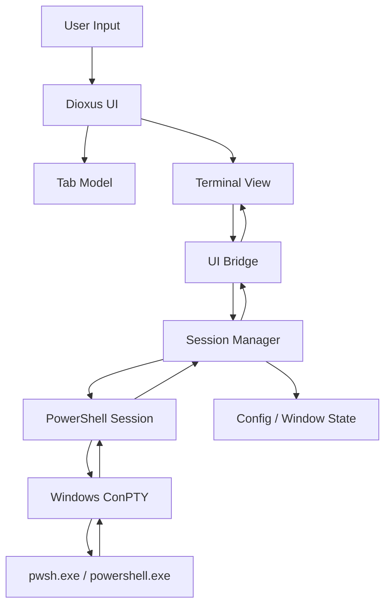

# Terminder 设计文档

## 1. 项目定位

Terminder 是一个面向 Windows 的现代化 PowerShell 桌面终端应用。它不再定位为通用跨平台终端框架，而是专注做好一个轻量、可靠、可多标签页使用的 PowerShell 工作窗口。

### 1.1 核心目标

- **Windows 优先**：基于 Windows ConPTY 管理 PowerShell 进程，优先适配 Windows 10/11。
- **PowerShell 优先**：默认启动 `pwsh.exe`，未安装 PowerShell 7 时回退到 Windows PowerShell `powershell.exe`。
- **多标签页窗口**：一个主窗口承载多个独立 PowerShell 会话，每个标签页拥有独立进程、工作目录、标题和生命周期。
- **Rust + Dioxus**：Rust 负责本机能力、进程管理、配置、状态和安全边界；Dioxus Desktop 负责窗口 UI、标签页、快捷键、状态栏和设置界面。
- **响应式体验**：终端输入输出不能阻塞 UI 线程；后台 I/O 与前端渲染通过事件通道解耦。

### 1.2 非目标

- 不在 MVP 阶段实现 SSH、WSL、Linux/macOS 支持。
- 不在 MVP 阶段实现插件市场或脚本扩展系统。
- 不自行实现完整 ANSI/VT 终端模拟器，除非后续性能或控制能力需要。
- 不替代 PowerShell 自身的 Profile、ExecutionPolicy、模块系统和历史记录机制。

## 2. 产品范围

### 2.1 MVP 功能

1. 启动一个 Windows 桌面窗口。
2. 默认创建一个 PowerShell 标签页。
3. 支持新建、关闭、切换、重命名标签页。
4. 每个标签页运行独立 PowerShell 进程。
5. 支持键盘输入、复制、粘贴、鼠标选择、滚动缓冲区。
6. 支持终端尺寸变化时同步 resize 到 ConPTY。
7. 支持基础配置：默认 shell、启动目录、字体、字号、主题、滚动行数。
8. 支持窗口状态恢复：窗口大小、最后工作目录、是否恢复上次标签页。
9. 支持常用快捷键。

### 2.2 后续功能

- 标签页拖拽排序、固定标签页、重复当前标签页。
- 命令面板。
- 分屏布局。
- 会话搜索。
- 命令片段收藏。
- PowerShell Profile 选择器。
- Windows Terminal 配色导入。
- 崩溃恢复和会话日志。

## 3. 技术选型

| 领域 | 方案 | 说明 |
| --- | --- | --- |
| 语言 | Rust | 本机进程、并发、安全和打包基础 |
| UI | Dioxus Desktop | 使用 Rust 组件模型构建桌面窗口和交互 |
| 桌面运行时 | Dioxus Desktop / WebView | 承载 HTML/CSS UI 与终端视图 |
| 终端渲染 | 内置 Web 终端视图 | MVP 使用成熟终端渲染组件处理 ANSI、选择、滚动和光标 |
| PTY | Windows ConPTY，经 `portable-pty` 封装 | 管理 PowerShell 伪终端 |
| 异步与并发 | Tokio + channel + dedicated I/O task | UI、会话状态、PTY I/O 解耦 |
| 配置 | `serde` + TOML | 用户可读、易迁移 |
| 错误处理 | `thiserror` / `anyhow` | 库层强类型错误，入口层聚合错误 |
| 日志 | `tracing` | 调试会话生命周期、I/O 和 UI 事件 |
| Windows API | `windows` crate | 仅在需要窗口、路径、进程树等原生能力时使用 |

### 3.1 终端渲染决策

Dioxus 负责应用 UI，但终端视图区不把每个字符都建模为 Dioxus 节点。终端输出频率高，如果把完整 Grid 放进 Dioxus signal，会导致大量 diff 和重绘。

MVP 采用以下策略：

- Rust 后端只负责 PowerShell 会话生命周期与字节流。
- Dioxus 标签页组件负责创建、挂载和销毁终端视图。
- 终端视图使用本地打包的终端渲染资源处理 ANSI、光标、选择和 scrollback。
- Dioxus state 只存储标签页元数据，不存储完整终端缓冲区。

后续如果需要更深控制能力，可替换为 `alacritty_terminal` + 自定义渲染层。替换点应隔离在 `ui::terminal` 和 `session` 事件协议之间。

## 4. 总体架构



### 4.1 分层职责

#### UI Layer

负责 Dioxus 组件、布局、交互、主题、快捷键和窗口状态。

核心组件：

- `AppShell`：应用根组件，挂载全局状态和事件循环。
- `TabStrip`：标签栏，新建、关闭、切换、重命名。
- `TerminalPane`：终端视图区，负责终端渲染组件挂载和前后端事件桥接。
- `StatusBar`：显示当前 shell、工作目录、进程状态、错误提示。
- `SettingsView`：配置编辑入口。

#### Application Layer

负责应用状态和动作分发。

核心对象：

- `AppState`：窗口级状态，包含 tab 列表、当前 tab、主题和配置。
- `SessionManager`：创建、关闭、查询 PowerShell 会话。
- `CommandRouter`：把 UI 动作映射为会话命令或应用命令。
- `ShortcutManager`：统一注册和解释快捷键。

#### Shell Layer

负责 Windows PowerShell 进程和 ConPTY。

核心对象：

- `PowerShellLocator`：查找 `pwsh.exe` / `powershell.exe`。
- `PowerShellSession`：持有 PTY、子进程、输入输出任务。
- `PtyReader`：读取 shell 输出并发送事件。
- `PtyWriter`：接收 UI 输入并写入 shell。
- `ProcessGuard`：关闭标签页时清理进程和资源。

#### Infrastructure Layer

负责文件系统、配置、日志、平台适配。

核心对象：

- `ConfigStore`：读取、写入、迁移配置。
- `WindowStateStore`：保存窗口大小、位置和最近工作目录。
- `LogInitializer`：初始化 tracing 输出。
- `WindowsPlatform`：封装 Windows 特定路径、进程和系统能力。

## 5. 代码结构

MVP 先使用单 crate，避免过早拆分 workspace。等 shell/session/ui 边界稳定后，再拆成多个 crate。

```text
Terminder/
  Cargo.toml
  assets/
    terminal/
      terminal.js
      terminal.css
  src/
    main.rs
    app.rs
    config/
      mod.rs
      model.rs
      store.rs
    platform/
      mod.rs
      windows.rs
    session/
      mod.rs
      command.rs
      event.rs
      manager.rs
      powershell.rs
    ui/
      mod.rs
      app_shell.rs
      tab_strip.rs
      terminal_pane.rs
      status_bar.rs
      settings.rs
    shortcuts.rs
    error.rs
    logging.rs
```

### 5.1 模块边界

- `ui` 不能直接操作 PTY 或子进程，只能发送 `SessionCommand`。
- `session` 不依赖 Dioxus，只通过 channel 发送 `SessionEvent`。
- `config` 不依赖 UI，提供纯数据结构和读写接口。
- `platform` 是 Windows 特定代码集中地，避免平台 API 扩散到业务模块。
- `main.rs` 只负责初始化日志、读取配置、启动 Dioxus。

## 6. 核心数据结构

### 6.1 标签页状态

```rust
#[derive(Clone, Copy, Debug, Eq, PartialEq, Hash)]
pub struct TabId(pub u64);

#[derive(Clone, Debug)]
pub struct TabState {
    pub id: TabId,
    pub title: String,
    pub cwd: std::path::PathBuf,
    pub shell: ShellKind,
    pub status: SessionStatus,
    pub unread_count: u32,
    pub is_renaming: bool,
}

#[derive(Clone, Debug)]
pub enum SessionStatus {
    Starting,
    Running,
    Exited { code: Option<i32> },
    Failed { message: String },
}

#[derive(Clone, Debug)]
pub enum ShellKind {
    Pwsh,
    WindowsPowerShell,
    Custom(std::path::PathBuf),
}
```

### 6.2 会话命令

```rust
#[derive(Debug)]
pub enum SessionCommand {
    Write { tab_id: TabId, bytes: Vec<u8> },
    Resize { tab_id: TabId, cols: u16, rows: u16 },
    SetTitle { tab_id: TabId, title: String },
    Close { tab_id: TabId, force: bool },
}
```

### 6.3 会话事件

```rust
#[derive(Debug)]
pub enum SessionEvent {
    Started { tab_id: TabId, pid: u32 },
    Output { tab_id: TabId, bytes: Vec<u8> },
    TitleChanged { tab_id: TabId, title: String },
    CwdChanged { tab_id: TabId, cwd: std::path::PathBuf },
    Exited { tab_id: TabId, code: Option<i32> },
    Error { tab_id: TabId, message: String },
}
```

### 6.4 配置模型

```rust
#[derive(Clone, Debug, serde::Serialize, serde::Deserialize)]
pub struct AppConfig {
    pub shell: ShellConfig,
    pub terminal: TerminalConfig,
    pub window: WindowConfig,
    pub shortcuts: ShortcutConfig,
}

#[derive(Clone, Debug, serde::Serialize, serde::Deserialize)]
pub struct ShellConfig {
    pub explicit_path: Option<std::path::PathBuf>,
    pub prefer_pwsh: bool,
    pub startup_args: Vec<String>,
    pub startup_dir: StartupDir,
}

#[derive(Clone, Debug, serde::Serialize, serde::Deserialize)]
pub struct TerminalConfig {
    pub font_family: String,
    pub font_size: f32,
    pub scrollback_lines: usize,
    pub theme: String,
}
```

## 7. 关键流程

### 7.1 启动流程

1. `main.rs` 初始化日志。
2. `ConfigStore` 读取配置，缺失时写入默认配置。
3. `PowerShellLocator` 查找默认 shell。
4. Dioxus Desktop 创建主窗口。
5. `AppShell` 初始化 `AppState` 和 `SessionManager`。
6. 自动创建第一个标签页。
7. `SessionManager` 启动 PowerShell 会话。
8. `TerminalPane` 挂载终端视图并连接事件通道。

### 7.2 新建标签页

1. 用户点击 `+` 或按 `Ctrl+Shift+T`。
2. UI 发送 `AppCommand::NewTab`。
3. `AppState` 创建 `TabState { status: Starting }`。
4. `SessionManager` 根据配置创建 PowerShell 会话。
5. 会话启动成功后发送 `SessionEvent::Started`。
6. UI 更新标签页状态为 `Running` 并聚焦终端。

### 7.3 输入流程

1. 用户在 `TerminalPane` 中输入。
2. 终端视图产生字节输入。
3. UI bridge 发送 `SessionCommand::Write`。
4. `SessionManager` 找到对应 `PowerShellSession`。
5. `PtyWriter` 写入 ConPTY。
6. PowerShell 接收输入并执行。

### 7.4 输出流程

1. PowerShell 输出 stdout/stderr。
2. ConPTY 产生 VT 字节流。
3. `PtyReader` 读取字节并发送 `SessionEvent::Output`。
4. UI bridge 把字节写入对应终端视图。
5. 如果标签页未激活，更新 `unread_count` 或活动提示。

### 7.5 Resize 流程

1. `TerminalPane` 监听容器尺寸变化。
2. 终端视图根据字体测量计算 `cols` 和 `rows`。
3. UI 发送 `SessionCommand::Resize`。
4. `PowerShellSession` 调用 PTY resize。
5. PowerShell 感知新窗口尺寸，重新排版输出。

### 7.6 关闭标签页

1. 用户关闭标签页。
2. 如果进程仍在运行，显示确认提示。
3. 用户确认后发送 `SessionCommand::Close`。
4. `PowerShellSession` 优先执行温和关闭。
5. 超时仍未退出时，根据 `force` 决定是否 kill。
6. `SessionManager` 清理 channel、PTY、子进程句柄和 UI 状态。

## 8. Windows 与 PowerShell 适配

### 8.1 Shell 查找优先级

1. 用户配置的 `explicit_path`。
2. `pwsh.exe`，即 PowerShell 7。
3. `%SystemRoot%\System32\WindowsPowerShell\v1.0\powershell.exe`。

启动参数默认值：

```text
-NoLogo
```

可选参数由配置追加，例如 `-NoProfile`、`-ExecutionPolicy Bypass`。默认不禁用用户 Profile，保持 PowerShell 原生体验。

### 8.2 环境变量

创建会话时注入：

```text
TERM=xterm-256color
TERM_PROGRAM=Terminder
COLORTERM=truecolor
```

如果使用 Windows PowerShell 5.1 且出现编码问题，可在设置中提供兼容模式。兼容模式通过启动初始化命令设置 UTF-8 输出，但默认不修改用户环境。

### 8.3 工作目录

新标签页工作目录按以下顺序决定：

1. 用户指定的新标签页目录。
2. 当前激活标签页目录。
3. 配置中的默认启动目录。
4. 用户 Home 目录。

当前目录实时跟踪不作为基础 PTY 能力假设。MVP 可以只记录标签页启动目录；后续通过可选 PowerShell shell integration 在 prompt 中发送目录变更事件，再触发 `SessionEvent::CwdChanged`。

### 8.4 进程清理

关闭标签页时必须保证不遗留子进程和 PTY 句柄：

- 先关闭 PTY 输入端。
- 等待 PowerShell 自然退出。
- 超时后终止进程树；Windows 下优先使用 Job Object 管理子进程。
- 记录退出码和错误原因。
- UI 必须允许用户重新打开新标签页，不因单个会话失败而退出应用。

## 9. UI 设计

### 9.1 主窗口布局

```text
+--------------------------------------------------+
| Tab 1 | Tab 2 | +                         Window |
+--------------------------------------------------+
|                                                  |
|                Active Terminal                   |
|                                                  |
+--------------------------------------------------+
| pwsh | C:\Users\name | 120x32 | status           |
+--------------------------------------------------+
```

### 9.2 标签栏行为

- 单击切换标签页。
- 双击标签标题进入重命名。
- 鼠标中键关闭标签页。
- 关闭最后一个标签页时创建新的空标签页，除非用户关闭整个窗口。
- 非激活标签页有输出时显示活动标记。
- 出错标签页显示错误状态，但不阻塞其他标签页。

### 9.3 快捷键

| 快捷键 | 动作 |
| --- | --- |
| `Ctrl+Shift+T` | 新建标签页 |
| `Ctrl+Shift+W` | 关闭当前标签页 |
| `Ctrl+Tab` | 切换到下一个标签页 |
| `Ctrl+Shift+Tab` | 切换到上一个标签页 |
| `Alt+1` 到 `Alt+9` | 切换到指定标签页 |
| `Ctrl+Shift+C` | 复制 |
| `Ctrl+Shift+V` | 粘贴 |
| `Ctrl+,` | 打开设置 |
| `F11` | 全屏 |

### 9.4 粘贴策略

- 普通文本直接粘贴。
- 包含换行、控制字符或超过阈值长度的内容，弹出确认。
- 支持 bracketed paste，降低误执行多行命令的风险。

## 10. 状态管理与通信

### 10.1 Dioxus 状态原则

- `Signal<AppState>` 只保存 UI 元数据。
- 终端输出不进入全局状态。
- 大字节流通过 channel 和 terminal bridge 传递。
- 标签页切换只改变激活 tab，不重建会话。
- 终端实例按 tab 缓存，关闭 tab 时销毁。

### 10.2 Channel 设计

```text
UI Command Sender
  -> SessionManager command receiver
      -> PowerShellSession command sender

PowerShellSession event sender
  -> SessionManager event receiver
      -> UI event dispatcher
          -> Dioxus state update or TerminalPane write
```

### 10.3 背压策略

- 每个会话使用有界 channel。
- 输出事件按短时间窗口批处理，减少 UI bridge 调用次数。
- UI 忙碌时优先保留最新状态，避免无限积压。
- 单个会话异常刷屏时限制内存占用并记录 warning。

## 11. 错误处理

### 11.1 错误分类

- `ConfigError`：配置文件不存在、格式错误、迁移失败。
- `ShellLocateError`：找不到可用 PowerShell。
- `SessionError`：PTY 创建失败、进程启动失败、I/O 失败。
- `UiBridgeError`：终端视图未挂载、事件发送失败。
- `PlatformError`：Windows API 调用失败。

### 11.2 UI 呈现

- 当前标签页错误显示在终端区域和状态栏。
- 全局错误显示 toast 或顶部提示。
- 单个会话失败不退出应用。
- 配置错误可以回退默认配置，并提示用户修复原文件。

## 12. 安全策略

- 默认不自动执行用户未确认的命令。
- 粘贴多行命令需要确认。
- 日志默认不记录完整命令输入，避免泄露密钥和 token。
- 配置中的 shell 路径必须是本机绝对路径。
- 自定义 shell 启动参数在设置界面明确展示。
- 后续加入脚本或命令片段时，必须区分“保存文本”和“立即执行”。

## 13. 性能策略

1. **I/O 不阻塞 UI**：PTY 读写运行在 dedicated task 或 blocking thread。
2. **输出批处理**：把高频小输出合并为短帧批次。
3. **终端缓冲独立**：scrollback 由终端视图管理，不进入 Dioxus diff。
4. **标签页懒渲染**：非活跃 tab 保持会话运行，但减少不必要 UI 更新。
5. **资源上限**：限制 scrollback 行数、单次粘贴大小和输出 channel 容量。
6. **可观测性**：记录会话创建、退出、resize、错误和输出拥塞情况。

## 14. 配置文件

默认配置路径：

```text
%APPDATA%\Terminder\config.toml
```

示例：

```toml
[shell]
prefer_pwsh = true
# explicit_path = "C:\\Program Files\\PowerShell\\7\\pwsh.exe"
startup_args = ["-NoLogo"]
startup_dir = "CurrentTab"

[terminal]
font_family = "Cascadia Mono"
font_size = 13.0
scrollback_lines = 10000
theme = "system"

[window]
restore_last_size = true
restore_last_tabs = false
confirm_close_running_tab = true

[shortcuts]
new_tab = "Ctrl+Shift+T"
close_tab = "Ctrl+Shift+W"
next_tab = "Ctrl+Tab"
previous_tab = "Ctrl+Shift+Tab"
copy = "Ctrl+Shift+C"
paste = "Ctrl+Shift+V"
settings = "Ctrl+,"
```

## 15. 测试计划

### 15.1 单元测试

- `PowerShellLocator` 查找优先级。
- 配置默认值和迁移逻辑。
- `SessionManager` 的 tab id 分配和状态流转。
- 快捷键解析和冲突检测。
- 工作目录决策逻辑。

### 15.2 集成测试

- 启动 PowerShell 并执行简单命令。
- resize 后 shell 接收正确尺寸。
- 关闭会话后无残留子进程。
- 大量输出时 UI channel 不无限增长。
- `pwsh.exe` 不存在时回退到 Windows PowerShell。

### 15.3 手动验收

- 新建 20 个标签页后切换流畅。
- 在不同目录打开标签页。
- 多行粘贴有确认提示。
- PowerShell Profile 正常加载。
- 中文路径、中文输出、emoji 和 ANSI 颜色显示正常。
- 关闭窗口时能正确提示并清理运行中的会话。

## 16. 开发里程碑

### M0：应用骨架

- 建立 Dioxus Desktop 主窗口。
- 完成基础布局：标签栏、终端区域、状态栏。
- 接入配置读取和日志。

### M1：单会话 PowerShell

- 实现 PowerShell 查找。
- 实现 ConPTY 会话创建。
- 打通输入、输出、resize。
- 在终端视图中显示真实 PowerShell。

### M2：多标签页

- 实现 `SessionManager`。
- 支持新建、关闭、切换、重命名。
- 每个 tab 独立 shell 进程。
- 关闭异常会话不影响其他标签页。

### M3：可用性完善

- 支持快捷键。
- 支持复制、粘贴、多行粘贴确认。
- 支持窗口状态保存。
- 支持基础设置界面。

### M4：稳定性与发布

- 增加进程清理和异常恢复测试。
- 优化输出批处理和内存上限。
- 打包 release 构建。
- 编写用户安装和使用说明。

## 17. 设计取舍记录

### 17.1 从 GPUI 改为 Dioxus

旧设计使用 GPUI，并倾向把终端 Grid 作为 Rust UI 渲染对象。新设计改为 Dioxus，是为了更快构建桌面 UI、标签页和设置界面，同时保持 Rust 对本机能力的控制。

### 17.2 从通用终端改为 PowerShell 专用

旧设计抽象了通用终端、脚本引擎和插件能力。MVP 收敛为 Windows PowerShell 应用，可以减少跨平台差异、脚本沙箱和插件系统带来的复杂度，更快得到稳定可用版本。

### 17.3 从多 crate 改为单 crate 起步

旧设计一开始拆分为 `core`、`app`、`ui` 等 workspace crate。当前仓库还处于初始阶段，单 crate 更适合快速迭代。模块边界通过目录和接口保持清晰，等稳定后再拆分。

### 17.4 终端输出不进入 Dioxus 状态

终端输出是高频字节流，不适合进入响应式 UI 状态树。新设计把终端缓冲交给终端视图，把应用状态限制为 tab 元数据、配置和错误状态，避免 UI diff 成为性能瓶颈。
